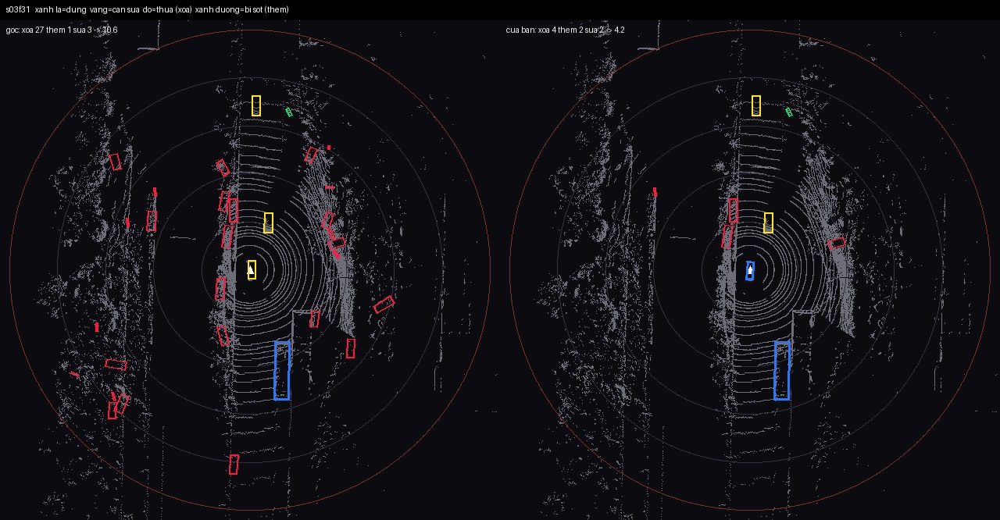

# Báo cáo Day 14 — Nguyễn Hoàng Nhân — 2A202603246

> Sao chép file này thành `report/individual/<MSSV>_<HoTen>.md` (không dấu), ví dụ `2A20260000_NguyenVanAn.md`.

- Mã học viên dùng với `--student`: `2A202603246`
- `seed_tag` trong `frames_A.txt`: `393590736f`

## 1. Dự đoán trước sweep (bước 5b)

Ghi **trước** khi chạy `scripts/pp_sweep.py`, rồi commit và push ngay (lịch sử commit là bằng chứng thời điểm viết). Không sửa phần này sau khi có kết quả.

- **Tham số tôi nghĩ giảm công sửa nhiều nhất:** `score_thr` (tăng từ `0.1` lên khoảng `0.4`–`0.5`), tiếp theo có thể cân nhắc `min_points` để lọc các box ít điểm ở xa.
- **Vì sao (nhìn ảnh BEV tập A: box thừa nhiều hay box sót nhiều?):** Ở ngưỡng thấp (`score_thr = 0.1`), mô hình sinh ra khá nhiều box có `score` thấp (khoảng `0.2`–`0.45`) hoặc ít điểm (`npts` nhỏ) nằm rải rác quanh vùng biên/xa tâm, trong khi các box đối tượng chính thường có `score` cao hơn rõ rệt. Do đó mình dự đoán **box thừa (false positive) chiếm ưu thế** hơn so với box sót, nên tăng `score_thr` sẽ loại bỏ nhanh các box nhiễu này và giảm chi phí xóa box đáng kể.

## 2. Tập A: sửa tay và tune

| Cấu hình | Xóa | Thêm | Sửa | Chi phí |
|---|---:|---:|---:|---:|
| Gốc | 59 | 4 | 8 | 25.7 |
| `best_config.json` | 14 | 5 | 7 | 12.7 |

*(Công thức chi phí từ `sweep.csv`: $\text{Chi phí} = 0.3 \times \text{Xóa} + 1.0 \times \text{Thêm} + 0.5 \times \text{Sửa}$)*

- **Tham số đã đổi trong `best_config.json`:** tăng `score_thr` từ `0.1` lên `0.5` (các tham số khác giữ nguyên: `min_points = 0`, `voxel_size = 0.16`, `nms_thr = 0.01`, `range_m = 50.0`).
- **Kết quả sweep / chi tiết từng frame trên tập A (`sweep.csv`):**
  - Cấu hình gốc (`score_thr=0.1`, `min_points=0`): `cost=25.7` (`delete=59, add=4, edit=8`) — chi phí từng frame: `s03f31 = 10.6`, `s04f06 = 6.2`, `s05f32 = 8.9`.
  - Cấu hình `best_config.json` (`score_thr=0.5`, `min_points=0`): `cost=12.7` (`delete=14, add=5, edit=7`) — chi phí từng frame: `s03f31 = 4.2`, `s04f06 = 4.4`, `s05f32 = 4.1`.
  - *(Lưu ý: nếu có log dòng in `LOO` từ terminal khi chạy `scripts/pp_sweep.py`, bạn có thể dán bổ sung nguyên văn tại đây).*
- **Cấu hình có ổn định trên từng frame không? Vì sao tôi vẫn chọn (hoặc không chọn) nó:**
  - Có, cấu hình `score_thr = 0.5` rất ổn định trên cả 3 frame của tập A: chi phí giảm đồng đều trên mọi frame (`s03f31` giảm từ `10.6` xuống `4.2`; `s04f06` giảm từ `6.2` xuống `4.4`; `s05f32` giảm từ `8.9` xuống `4.1`) và hội tụ về mức ~4.1–4.4/frame. Đồng thời, trong bảng `sweep.csv`, toàn bộ nhóm cấu hình có `score_thr = 0.5` đều đạt chi phí thấp nhất (`12.7`), không nhạy cảm với `min_points` (`0`, `5`, `10` cho kết quả như nhau), nên đây là lựa chọn tối ưu và an toàn nhất.

## 3. Trước/sau (bước 8)

- `scripts/pp_compare.py` báo giảm **50.58%** công sửa trên tập A (từ `25.7` xuống `12.7`, tiết kiệm `13.0` đơn vị chi phí).
- **Dự đoán ở mục 1 đúng hay sai? Giải thích bằng số box xóa/thêm/sửa:**
  - **Đúng hoàn toàn.** Ở cấu hình gốc (`score_thr = 0.1`), số box thừa cần xóa lên tới **59 box** (chiếm phần lớn lỗi với $59 \times 0.3 = 17.7$ chi phí), trong khi số box thiếu cần thêm chỉ có **4 box** và box cần sửa là **8 box**. Khi nâng `score_thr = 0.5`, số box thừa phải xóa giảm mạnh **45 box** (từ `59` xuống `14`), số box cần sửa giảm nhẹ từ `8` xuống `7`, trong khi số box bỏ sót cần thêm chỉ tăng thêm **1 box** (từ `4` lên `5`). Nhờ đánh đổi rất có lợi giữa việc loại bỏ 45 box nhiễu và chỉ mất thêm 1 box thật, tổng công sửa giảm hơn một nửa.

## 4. Tập B

Số đo từ `scripts/pp_prelabel.py --frames d14_2A202603246/frames_B.txt --config d14_2A202603246/best_config.json --gt d14_2A202603246/ref_B.json`:

| Xóa | Thêm | Sửa | Chi phí |
|---:|---:|---:|---:|
| 39 | 13 | 8 | 28.7 |

*(Trung bình `2.39` chi phí/frame trên 12 frame tập B, thấp hơn mức trung bình `4.23` chi phí/frame trên tập A).*

- **Loại box tốn công sửa nhất ở tập B:**
  - Tính theo tổng chi phí: **Box thừa cần xóa (`Delete`)** chiếm tỷ trọng chi phí lớn nhất với **39 box** ($39 \times 0.3 = 11.7$ đơn vị chi phí), chủ yếu là các dự đoán `Car` và `Cyclist` có điểm tin cậy trung bình (`score` từ `0.50` đến `0.68`) ở rìa vùng quét hoặc nhận nhầm từ vật thể ven đường.
  - Xét theo đơn giá trên mỗi box và nguyên nhân hệ thống: **Box bị bỏ sót cần thêm (`Add`)** tốn công nhất trên từng đối tượng ($1.0/\text{box}$, tổng **13 box** = $13.0$ chi phí), tập trung vào cụm `Pedestrian` ở xa (`s01f02`) và các xe cỡ lớn (`Truck`, `Bus` ở `s01f02`, `s02f01`, `s05f20`, `s05f46`); ngoài ra nhóm **box cần sửa (`Edit`, 8 box = $4.0$ chi phí)** chủ yếu là các xe tải `Truck` bị mô hình gán nhầm nhãn thành `Car` (như tại `s01f28`, `s01f46`, `s04f18`, `s05f01`) hoặc lệch hướng `yaw` ngược chiều $\pi$.

## 5. Giới hạn

1. **Tập tune (tập A) quá nhỏ (chỉ 3 frame):** Việc tối ưu tham số trên 3 frame dễ gây hiện tượng quá khớp (overfitting) vào mật độ điểm và phân bố đối tượng cục bộ; khi áp dụng sang 12 frame đa dạng hơn ở tập B, số box bị bỏ sót (`Add`) tăng lên 13 box (đặc biệt là người đi bộ và xe tải/xe buýt).
2. **Giới hạn của mô hình pretrained KITTI (thiếu lớp `Truck` và `Bus`) và luật hậu xử lý kích thước:** Mô hình gốc chỉ dự đoán `Car`, `Pedestrian`, `Cyclist`. Dù cấu hình có luật nâng hạng sang `Truck` (`truck_l_min = 5.6`, `truck_h_min = 2.4`) và `Bus` (`bus_l_min = 9.0`, `bus_h_min = 2.8`), nhiều xe tải/xe buýt trong tập B bị ước lượng thiếu chiều dài/chiều cao (do chỉ thấy một mặt từ LiDAR) nên vẫn bị giữ nhãn `Car` hoặc bị loại bỏ hoàn toàn.
3. **Giới hạn vùng quét (`range_m = 50.0`):** Các đối tượng ground-truth nằm ngoài bán kính 50 m (ví dụ `Car` ở `66.45 m` tại `s03f31` và `Truck` ở `74.81 m` tại `s05f32`) chắc chắn bị bỏ sót và phải thêm thủ công bất kể chỉnh `score_thr` thế nào.
4. **Hàm chi phí chỉ là xấp xỉ tuyến tính:** Công thức `0.3 * Xóa + 1.0 * Thêm + 0.5 * Sửa` chưa phản ánh đầy đủ thời gian thao tác thực tế trong công cụ gán nhãn 3D (ví dụ: vẽ mới một box `Pedestrian` nhiều điểm mất thời gian khác với kéo dài kích thước một box `Truck` hoặc xoay lại góc `yaw` bị ngược 180°).
